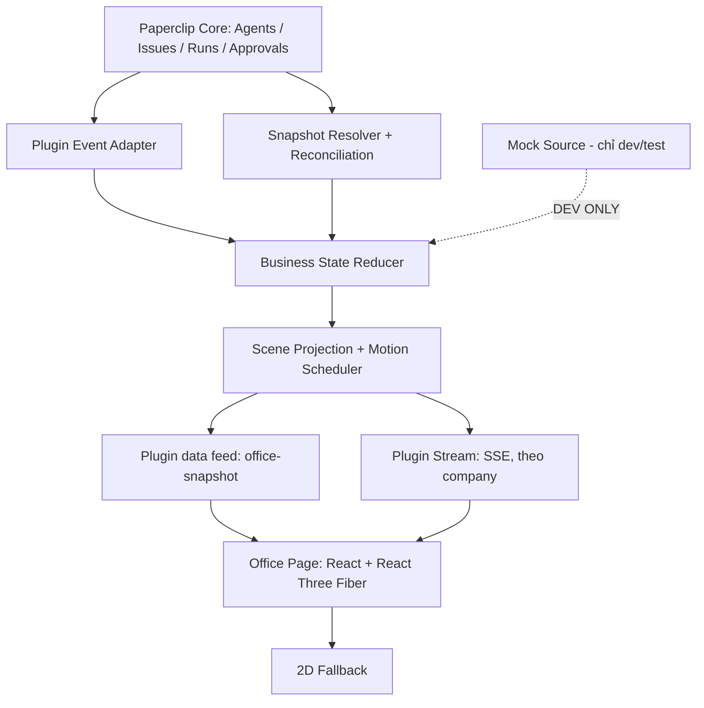
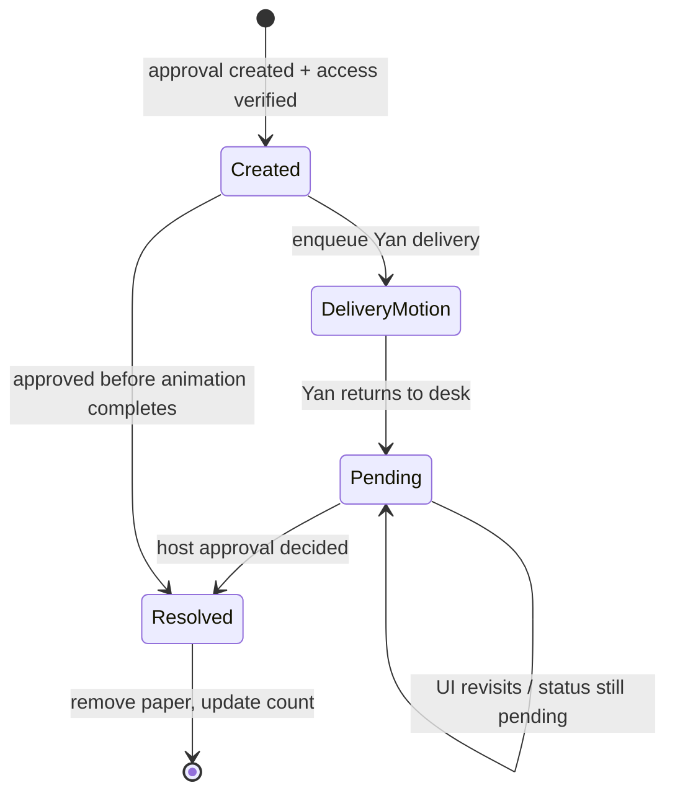

# VPD OFFICE 3D — BẢN THIẾT KẾ CHI TIẾT TỐI ƯU

> **Loại tài liệu:** Product Design Document + Technical Design Specification (PDD/TDS)  
> **Phiên bản:** 1.0 — bản thiết kế đề xuất, chưa triển khai  
> **Ngày:** 25/11/2026  
> **Phạm vi:** Plugin **Office** cho Paperclip, triển khai ưu tiên tại công ty **VPD-Video**; kiến trúc mở rộng nhiều công ty  
> **Nguồn nền:** `Thiết kế VPD Office 3D (plugin Paperclip).md` do người dùng cung cấp  
> **Mục đích:** Làm tài liệu đầu vào thống nhất để AI coding agent hoặc đội phát triển triển khai, kiểm thử và nghiệm thu.

---

## 0. Quy tắc đọc tài liệu — phân biệt quyết định CEO và AI đề xuất

Các nhãn được dùng trong toàn bộ tài liệu:

- **[CEO-LOCKED]** — quyết định đã được CEO chốt trong bảng đầu tài liệu nguồn, **không được tự ý thay đổi**.
- **[SOURCE-BASELINE]** — chi tiết có trong tài liệu nguồn nhưng **không chứng minh là CEO đã duyệt riêng**; ưu tiên kế thừa nếu không xung đột hoặc làm giảm chất lượng.
- **[AI-DESIGN]** — phương án AI thiết kế hoặc sửa tối ưu hóa; là **đề xuất triển khai**, không được trình bày như quyết định CEO.
- **[CEO-PENDING]** — các lựa chọn tài liệu nguồn ghi rõ còn chờ CEO quyết. Giá trị mặc định trong tài liệu này chỉ dùng cho **prototype/mock**, chưa được coi là chấp thuận.
- **[VERIFY-FORK]** — phải kiểm chứng trong commit và phiên bản SDK thật của repository `hoanghahuy2005/paper-clip-qlda` trước khi viết mã phụ thuộc API.

**Quy tắc ưu tiên nếu có mâu thuẫn:** `CEO-LOCKED` > yêu cầu an toàn/không ghi dữ liệu > tính đúng của Paperclip thực tế > thiết kế AI > chi tiết chưa được duyệt của tài liệu nguồn. Không dùng nguyên tắc ưu tiên này để vượt qua quyền CEO: nếu yêu cầu CEO chốt không thực hiện được về kỹ thuật, phải lập báo cáo chặn triển khai và đề xuất lựa chọn để CEO quyết.

### 0.1. Sổ quyết định CEO phải giữ nguyên

| ID | Nội dung | Nguồn và trạng thái | Yêu cầu bất biến |
|---|---|---|---|
| CEO-01 | VPD Office 3D là **plugin Paperclip** có mục **Office** trên sidebar và một trang riêng | [CEO-LOCKED], 25/11 | Không chuyển thành ứng dụng độc lập hay sửa trực tiếp màn hình chính thay vì plugin |
| CEO-02 | **Chỉ xem**; phê duyệt, giao việc và sửa dữ liệu vẫn thực hiện trên Paperclip | [CEO-LOCKED], 25/11 | Không tạo nút thay đổi issue, agent, budget, approval trong Office |
| CEO-03 | Dùng **model GLB low-poly có animation từ đầu** | [CEO-LOCKED], 25/11 | Không thay bằng icon 2D đơn thuần làm sản phẩm chính; 2D chỉ là fallback |
| CEO-04 | **Yan tự tới phòng CEO nộp hồ sơ rồi quay về bàn** | [CEO-LOCKED], 25/11 | Việc chờ duyệt không giữ Yan đứng bất động ở phòng CEO |
| CEO-05 | Có **phòng CEO** và **khu nghỉ chung**; **bỏ trạm công cụ và kho tài sản** | [CEO-LOCKED], 25/11 | Không tự thêm lại hai khu đã loại bỏ |
| CEO-06 | **2 người:** nhắn tin hoặc đứng sát; **từ 3 cùng phòng:** họp ở phòng ban; **từ 3 khác phòng:** họp ở phòng họp | [CEO-LOCKED], 24/11 | Luật vị trí phải áp dụng cho các cuộc họp đủ điều kiện xác nhận |
| CEO-07 | Agent chỉ di chuyển theo **việc thật trên Paperclip**; ngoại lệ là đi nghỉ khi rảnh. Tắt plugin không ảnh hưởng công việc | [CEO-LOCKED] theo nguyên tắc nêu ngay sau bảng quyết định | Không cho nhân vật đi qua lại ngẫu nhiên để trang trí |

### 0.2. Những mục chưa được CEO chốt

| ID | Vấn đề | Mặc định AI dùng cho bản mẫu, **không phải phê duyệt** |
|---|---|---|
| P-01 | Phong cách mỹ thuật cụ thể | 3 concept **sa bàn low-poly sáng, sạch, dễ đọc** để CEO chọn |
| P-02 | Màu và phụ kiện cuối cùng của 12 nhân vật | Dùng bảng nhân sự trong tài liệu nguồn để mock, chưa khóa asset production |
| P-03 | Ngưỡng rảnh để đi nghỉ | `idleLoungeAfterSeconds = 300` (5 phút) |
| P-04 | Yan có nhắc lại hồ sơ sau 2 heartbeat hay không | `approvalReturnReminderEnabled = false` để tránh đi lại không cần thiết; có thể bật khi CEO duyệt |
| P-05 | Nhiều công ty dùng mặt bằng riêng hay tòa nhà nhiều tầng | `layoutMode = separate_company_layouts` cho bản mẫu, không chốt kiến trúc thế giới 3D cuối cùng |

> **Phân biệt quan trọng:** CEO đã quyết **có khu nghỉ**, chưa quyết **5 phút**. CEO đã quyết **Yan nộp hồ sơ**, chưa quyết **nhắc hồ sơ lần hai**. Không tự nâng các mặc định này lên thành chính sách công ty.

---

## 1. Mục tiêu sản phẩm và phạm vi

### 1.1. Vấn đề cần giải quyết

CEO quản lý một hoặc nhiều công ty Multi-Agent trên Paperclip. Danh sách issue, run và approval thể hiện dữ liệu chính xác nhưng khó cung cấp cảm giác tổng quan về ai đang làm gì, ai đang phối hợp, việc nào đang chờ CEO và sự cố nằm ở đâu. **VPD Office 3D là lớp trực quan hóa trạng thái** chứ không phải một hệ thống quản lý công việc song song.

### 1.2. Kết quả mong đợi

1. CEO nhìn được **12 agent VPD-Video** trong không gian văn phòng với đúng cơ cấu bộ phận.
2. Mỗi hoạt ảnh làm việc, đi lại, bàn giao, họp hoặc gặp lỗi có **nguyên nhân nghiệp vụ truy vết được**.
3. Hồ sơ cần CEO quyết được đặt tại phòng CEO và liên kết tới đúng trang duyệt thật của Paperclip.
4. CEO xem trạng thái, issue và bình luận bằng panel trực quan, không phải rời khỏi Paperclip để sử dụng một ứng dụng khác.
5. Tắt/hỏng plugin không làm dừng heartbeat, run, issue, workflow hoặc approval của Paperclip.
6. Thiết kế không bị khóa cứng vào duy nhất VPD-Video; nguồn cấu hình được tách theo `companyId`.

### 1.3. Ngoài phạm vi

- Không thay đổi luật điều hành PM/agent của Paperclip; không ra lệnh cho agent từ Office.
- Không ghi approval hoặc issue qua các tương tác 3D.
- Không tạo cuộc họp thực từ 3D; Office chỉ phản ánh workflow đã có dữ liệu xác nhận.
- Không tích hợp voice chat, webcam, avatar CEO hoặc multiplayer trong phiên bản này.
- Không dựng lại "trạm công cụ" hay "kho tài sản" đã bị CEO loại bỏ.
- Không coi motion tự phát, suy đoán từ LLM hoặc dữ liệu mock là sự kiện thực.

### 1.4. Sáu nguyên tắc kiến trúc

1. **Single Source of Truth:** Paperclip sở hữu nghiệp vụ. Plugin sở hữu state hiển thị và asset.
2. **Read-only by design:** tất cả tính năng trong Office là quan sát và điều hướng.
3. **Evidence-driven visualization:** chuyển động cần có event/task/approval tương ứng; event giả chỉ dùng trong Mock Mode có nhãn rõ.
4. **Deterministic & recoverable:** cùng snapshot + sự kiện hợp lệ cho cùng một kết quả trạng thái; reconnect không phát lại lịch sử.
5. **Company-scoped:** tất cả dữ liệu và cập nhật đều có `companyId` và phải kiểm soát quyền.
6. **Progressive rendering:** cấu hình 3D phục vụ desktop/mobile; có fallback 2D từ cùng state.

---

## 2. Cơ cấu công ty VPD-Video và quyền hạn

### 2.1. Danh sách agent hiện tại — giữ nguyên 12 vị trí của tài liệu nguồn

| Mã tham chiếu trong Office | Agent | Phòng | Màu nhận diện mock | Vai trò trong văn phòng |
|---|---|---|---|---|
| `pm` | Yan (PM) | PM | Xám than | Điều phối và nộp hồ sơ CEO |
| `creative_director` | Creative Director | Sáng tạo | Vàng mù tạt | Đầu mối phòng sáng tạo |
| `scriptwriter` | Scriptwriter | Sáng tạo | Vàng mù tạt | Viết kịch bản |
| `shot_planner` | Shot Planner | Sáng tạo | Vàng mù tạt | Kế hoạch phân cảnh |
| `ai_production_lead` | AI Production Lead | Sản xuất AI | Xanh dương | Đầu mối sản xuất AI |
| `character_consistency` | Character & Consistency | Sản xuất AI | Xanh dương | Nhân vật và tính nhất quán |
| `visual_generator` | Visual Generator | Sản xuất AI | Xanh dương | Hình ảnh/asset |
| `voice_audio` | Voice & Audio | Sản xuất AI | Xanh dương | Giọng nói và audio nguồn |
| `video_editor` | Video Editor | Hậu kỳ | Tím | Đầu mối hậu kỳ |
| `motion_subtitle` | Motion & Subtitle | Hậu kỳ | Tím | Chuyển động, phụ đề |
| `color_sound` | Color & Sound Mix | Hậu kỳ | Tím | Màu sắc và mix âm thanh |
| `qa_reviewer` | QA Reviewer | QA | Xanh ngọc | Kiểm soát chất lượng |

**Ràng buộc:** Những mã ở cột đầu chỉ là alias trong file cấu hình, **không phải UUID thật**. Khi khởi động, phải ánh xạ sang `agentId` của công ty từ API Paperclip. Không được gán agent dựa duy nhất vào tên hiển thị nếu trùng tên.

**[AI-DESIGN] Vấn đề “4 trưởng phòng”:** Tài liệu nguồn nói Yan họp với 4 trưởng phòng nhưng bảng vai trò rõ ba đầu mối quản lý (Creative Director, AI Production Lead, Video Editor). QA Reviewer là đầu mối QA trong kickoff/tổng kết, **không tự đổi chức danh QA Reviewer thành QA Lead**. Danh sách dự họp cấu hình là `Yan + Creative Director + AI Production Lead + Video Editor + QA Reviewer`; đối với quyền quản lý thật, tiếp tục lấy quan hệ `reportsTo` từ Paperclip.

### 2.2. Ma trận trách nhiệm

| Công việc | CEO | Yan/PM | Trưởng phòng | Agent chuyên môn | Plugin Office |
|---|---|---|---|---|---|
| Mục tiêu, ngân sách ngoài quyền PM, các phê duyệt quan trọng | Quyết | Đề xuất/trình | Góp ý | Cung cấp dữ liệu | Chỉ hiển thị |
| Lập kế hoạch và phân công trong quyền PM | Theo dõi | Quyết | Triển khai | Thực hiện | Chỉ hiển thị |
| Tạo/cập nhật issue | Trên Paperclip khi cần | Trên Paperclip | Trên Paperclip | Theo quyền Paperclip | **Không được ghi** |
| Đánh giá chất lượng/G1/G2/G3 | Duyệt những cổng quy định | Điều phối | Đánh giá | Bàn giao | Chỉ hiển thị |
| Điều khiển hoạt ảnh/camera | Xem và điều hướng | Không can thiệp | Không can thiệp | Không can thiệp | Tự xử lý hiển thị |

Office **không tạo thêm cấp phê duyệt**. Trạng thái "chờ CEO" phải bắt nguồn từ approval/confirmation có thực và có đường dẫn kiểm tra.

---

## 3. Kiến trúc hệ thống

### 3.1. Sơ đồ tổng thể



### 3.2. Phân lớp và nhiệm vụ

| Lớp | Chạy ở đâu | Nhiệm vụ | Không được làm |
|---|---|---|---|
| Paperclip Core | Host | Lưu dữ liệu nghiệp vụ, run và approval | Phụ thuộc vào renderer Office |
| Event Adapter | Plugin worker | Nhận sự kiện, xác minh payload, ánh xạ loại, lọc company | Tự giả sự kiện quản lý |
| Snapshot Resolver | Plugin worker | Tải danh sách agent, task, approval và run hiện tại | Đánh dấu agent rảnh khi dữ liệu chưa tải xong |
| Business State Reducer | Plugin worker | Duy trì state nghiệp vụ nhất quán, chống trùng và lỗi thứ tự | Đưa ra chuyển động camera |
| Scene Projection | Plugin worker (logic thuần) | Chuyển trạng thái nghiệp vụ thành ý định hiển thị/điểm đến | Coi chuyển động là sự kiện nghiệp vụ |
| Motion Scheduler | UI (theo chỉ đạo projection) | Animation blend, xếp hàng, điều hướng không va chạm | Tạo cuộc họp hoặc phê duyệt mới |
| 3D UI | Browser | Render GLB, bố cục, UI, điều khiển camera, liên kết | Ghi dữ liệu Paperclip |
| Mock Source | Dev/test | Sinh fixture kiểm thử có thể lặp lại | Hoạt động trong Production Mode |

**[VERIFY-FORK]** Trước triển khai cần kiểm tra SDK thực sự có `ctx.events.on`, `ctx.data.register`, `ctx.streams.open/emit/close`, `usePluginData`, `usePluginStream`, `useHostNavigation` và slot `page`/`sidebar`. Tài liệu upstream có mô tả các thành phần này, nhưng không được xem là bằng chứng fork đã hỗ trợ hoàn toàn.

### 3.3. Transport realtime — ưu tiên SSE theo SDK

- **Snapshot:** UI đọc qua data feed `office-snapshot` trước khi dựng scene.
- **Cập nhật:** worker phát sự kiện UI đã chuẩn hóa qua `ctx.streams`, UI đăng ký `usePluginStream`.
- **Kênh:** đề xuất tên `office-updates:<companyId>`; mỗi kênh luôn gắn với đúng `companyId` để không trộn luồng của hai công ty. Tên kênh là chi tiết đề xuất, phải kiểm tra giới hạn SDK.
- **Không tự dựng WebSocket route** ở MVP nếu SSE của fork đủ để chuyển state một chiều. WebSocket tùy biến chỉ được đề xuất lại khi Phase 0 chứng minh SSE không đáp ứng.
- **Mỗi khi UI load hoặc reconnect:** lấy snapshot mới; stream không phải nơi lưu trữ lịch sử có độ tin cậy tuyệt đối.
- **Khi UI không mở:** worker vẫn có thể nhận event nhưng không được chặn hoặc làm chậm Paperclip; state có thể khôi phục từ host, không cần giữ mọi animation trong RAM.

### 3.4. Lưu state và thứ tự ưu tiên

- State dữ liệu thật đọc từ Paperclip; cache worker là dẫn xuất, có thể tái tạo.
- Cấu hình layout phải version hóa; config không chứa secret.
- Snapshot chứa `snapshotId`, `generatedAt`, `companyId`, `layoutVersion`, `revision`.
- Event UI chứa `epoch` (ID phiên worker), `sequence` tăng dần **trong cùng epoch/company**, `eventId`, `occurredAt`, `companyId`.
- Khi `epoch` đổi hoặc `sequence` nhảy có gap: không suy đoán các sự kiện bị bỏ lỡ; yêu cầu snapshot mới.
- Deduplicate dựa trên `eventId`/source version; event tới trễ không được lùi trạng thái.
- Không phát lại những chuyến đi trong lúc user đóng trang; lần mở mới chỉ vẽ state hiện tại.

### 3.5. Nguyên tắc về quyền

Manifest ban đầu dự kiến chỉ xin các capability đã xác minh và thực sự cần, chẳng hạn `agents.read`, `issues.read`, `issue.comments.read`, `companies.read`, `projects.read`, `events.subscribe`, `ui.page.register`, `ui.sidebar.register`, `plugin.state.read`/`write` nếu dùng cache cấu hình. **Không** xin `issues.create`, `issues.update`, `agents.invoke`, `approval` mutation, budget override.

**[VERIFY-FORK]** Capability `approvals.read` được nêu trong tài liệu nguồn **chưa thấy trong bảng capability upstream đã kiểm tra**. Không được ghi cứng vào manifest và giả định hợp lệ. Kiểm tra host API đọc approval hiện thực; nếu plugin không có đường đọc hợp lệ thì **không được dựng danh sách phê duyệt giả** và coi đây là blocker cho chức năng phòng CEO.

---

## 4. Hợp đồng dữ liệu chuẩn (data contracts)

### 4.1. Domain state và visual state là hai tầng khác nhau

```ts
// Pseudotype để làm hợp đồng thiết kế, chưa phải mã SDK cài đặt.
type WorkState = "working" | "idle" | "error" | "paused" | "unknown";
type ActivityContext = "none" | "discussion" | "handoff" | "review" | "meeting" | "approval_delivery";
type MotionState =
  | "sitting_idle" | "typing" | "standing" | "walking"
  | "talking" | "handing_document" | "nodding"
  | "error_reaction" | "resting";

interface OfficeAgent {
  companyId: string;
  agentId: string;               // UUID thật từ Paperclip
  alias: string;                 // alias hiển thị/config
  displayName: string;
  departmentId: string;
  deskAnchorId: string;
  workState: WorkState;
  activeRunId: string | null;
  activeIssueId: string | null;
  openAssignedIssueCount: number | null; // null = chưa xác minh, không đủ điều kiện đi nghỉ
  lastWorkEndedAt: string | null;
  context: ActivityContext;      // không thay cho workState
  motion: MotionState;           // chỉ thuộc renderer
  lastSourceUpdatedAt: string;
}

interface OfficeApproval {
  companyId: string;
  approvalId: string;            // phải có thực trên host
  issueId: string | null;
  creatorAgentId: string | null;
  type: string;
  title: string;
  createdAt: string;
  status: "pending" | "approved" | "rejected" | "revision_requested";
  hostRoute: string;             // validated internal route
}
```

### 4.2. Snapshot giao diện (ví dụ minh họa, không phải dữ liệu production)

```json
{
  "schemaVersion": 1,
  "snapshotId": "mock-snapshot-001",
  "companyId": "company-demo",
  "companyName": "VPD-Video",
  "generatedAt": "2026-11-25T14:00:00+07:00",
  "epoch": "worker-session-demo",
  "revision": 125,
  "layoutVersion": "vpd-video-v1",
  "sourceHealth": "live",
  "agents": [
    {
      "agentId": "agent-yan-demo",
      "alias": "pm",
      "workState": "working",
      "activeIssueId": "issue-demo-001",
      "activeRunId": "run-demo-001",
      "context": "none"
    }
  ],
  "pendingApprovals": [],
  "meetings": [],
  "recentEvents": []
}
```

**Mặc định bảo vệ tính đúng:** `sourceHealth = "unknown" | "stale" | "unavailable"` phải hiển thị thông báo. Không được hiển thị trạng thái `idle` chỉ vì request timeout.

### 4.3. Event nội bộ giữa worker và UI

```ts
interface OfficeUiEvent {
  schemaVersion: 1;
  eventId: string;
  sourceEventId?: string;
  companyId: string;
  epoch: string;
  sequence: number;
  occurredAt: string;
  emittedAt: string;
  type:
    | "agent.state.changed"
    | "agent.issue.changed"
    | "conversation.display"
    | "handoff.display"
    | "meeting.display.started"
    | "meeting.display.updated"
    | "meeting.display.ended"
    | "approval.display.created"
    | "approval.display.resolved"
    | "office.snapshot.required";
  payload: Record<string, unknown>;
}
```

Các chuỗi `agent.state.changed`, `meeting.display.started` ... **chỉ là sự kiện nội bộ của VPD Office**, không phải tên event của Paperclip.

### 4.4. Cấu hình công ty (`company-layout.json`)

Mọi đối tượng nội thất có tọa độ rõ ràng; `agentId` được phân giải động. Không viết cứng UUID, không dựa vào họ tên/biệt danh để gán quyền.

```json
{
  "schemaVersion": 1,
  "companyKey": "vpd-video",
  "layoutVersion": "vpd-video-v1",
  "units": "meter",
  "axes": { "horizontal": "x", "depth": "z", "up": "y" },
  "floor": { "minX": -17, "maxX": 17, "minZ": -12, "maxZ": 12, "y": 0 },
  "rooms": [
    { "id": "meeting", "label": "Phòng họp", "x": [-17, -7], "z": [-12, -5] },
    { "id": "creative", "label": "Sáng tạo", "x": [-7, 5], "z": [-12, -5] },
    { "id": "ai_production", "label": "Sản xuất AI", "x": [5, 17], "z": [-12, -5] },
    { "id": "ceo", "label": "CEO", "x": [-17, -11], "z": [5, 12] },
    { "id": "pm", "label": "PM", "x": [-11, -5], "z": [5, 12] },
    { "id": "post", "label": "Hậu kỳ", "x": [-5, 7], "z": [5, 12] },
    { "id": "qa", "label": "QA", "x": [7, 17], "z": [5, 12] }
  ],
  "lounge": { "id": "lounge", "x": [-5, 5], "z": [-2, 2], "capacity": 12 },
  "primaryCorridors": [
    { "id": "upper", "z": [-5, -2] },
    { "id": "lower", "z": [2, 5] }
  ],
  "settings": {
    "idleLoungeAfterSeconds": 300,
    "approvalReturnReminderEnabled": false,
    "maxVisibleDocumentsOnTray": 8,
    "maxRecentEvents": 50
  }
}
```

**Lưu ý:** Đây là một **configuration skeleton**, chưa phải toàn bộ JSON đủ để render/nav. Bộ sinh layout phải bổ sung và validate `doors`, `navNodes`, `navEdges`, `desks`, `chairs`, `meetingSlots`, `loungeSlots`, `cameraPresets`, `obstacles`, `assetRefs`. Xem mục 8 và mục 14 để tránh biến ví dụ này thành layout production chưa kiểm thử.

---

## 5. Ánh xạ event Paperclip sang trạng thái văn phòng

### 5.1. Các event nguồn cần xác minh

Những tên dưới đây có trong tài liệu event/plugin upstream. **Việc tên có trong tài liệu chưa chứng minh fork đang phát event tại runtime.**

| Paperclip event (đầu vào dự kiến) | Biến đổi ở worker | Kết quả trong Office |
|---|---|---|
| `agent.run.started` | Có run đang hoạt động, cập nhật issue/run id | Về bàn nếu cần; ngồi gõ phím |
| `agent.run.finished` | Đọc lại open-task state | Kết thúc typing, về idle/đúng context |
| `agent.run.failed` | Đánh dấu lỗi nếu run cuối còn phù hợp | Hiệu ứng lỗi tại bàn, không đi nghỉ |
| `agent.run.cancelled` | Đọc lại status; không suy ra luôn là lỗi | Tạm dừng hoặc về idle theo host |
| `agent.status_changed` | Đồng bộ paused/running/... | Đổi ring/icon theo status thật |
| `issue.created` | Có thể tạo handoff khi quan hệ task được xác nhận | Chỉ chạy animation bàn giao nếu đủ điều kiện |
| `issue.updated` | Cập nhật assignment/status/issue label | Mã task/hoàn thành, không tự tổ chức họp |
| `issue.comment.created` | Hiển thị lời nói ngắn + actor thật | Bubble hoặc thư giữa bàn; không tự coi là meeting |
| `approval.created` | Nếu là approval có quyền đọc và liên quan CEO | Yan đi nộp một hồ sơ; tăng pending count |
| `approval.decided` | Đọc lại trạng thái approval | Hồ sơ rời khay; Yan không bị khóa ở CEO |
| `budget.incident.opened` | Đọc tình trạng run/agent | Cảnh báo; không tùy tiện đổi mọi agent thành error |
| `budget.incident.resolved` | Reconcile trạng thái thật | Xóa cảnh báo nếu đã giải quyết |

**[VERIFY-FORK, P0]** Từng có báo cáo về các event `agent.run.finished/failed/cancelled` được khai báo nhưng không được emit ở một số phiên bản Paperclip. Do đó Phase 0 **bắt buộc kiểm tra bằng trigger thực tế**. Nếu thiếu event, có hai phương án kỹ thuật cần so sánh: (a) adapter đọc trạng thái run bằng API với polling có giới hạn, (b) bổ sung/cập nhật event ở host bằng thay đổi riêng và có review. Không được coi tên trong SDK là bảo đảm đủ SLA 2 giây.

### 5.2. Chính sách xác nhận dữ liệu

- `issue.comment.created` không chứng minh hai agent cùng online; chỉ dùng để hiển thị **trao đổi không đồng bộ**.
- `issue.updated` không tự động đồng nghĩa "handoff trực tiếp" nếu không xác nhận được người gửi và nhận qua quan hệ task/assignment.
- `approval.created` chỉ khiến Yan nộp hồ sơ nếu approval được gắn với CEO hoặc luồng Yan trình duyệt; nếu không rõ, vẫn hiện trong list nếu được phép nhưng **không dựng cảnh Yan nộp sai**.
- `request_confirmation` chỉ được coi là hồ sơ chờ CEO nếu thực sự có entity/record hoặc một issue trạng thái yêu cầu phê duyệt truy xuất được; một lời nhắc trong transcript không đủ để giả hồ sơ.
- Event source của actor/recipient mơ hồ phải có `confidence: low`, chỉ cập nhật panel, không ép nhân vật di chuyển.

### 5.3. Fallback khi event chưa hoàn chỉnh

1. Subscribe event có thể dùng được để có độ trễ thấp.
2. Khi có `run.started`, theo dõi riêng run đang hoạt động bằng API **đọc** nếu không có event kết thúc; kiểm tra 1–2 giây/lần *chỉ trong giai đoạn run active và khi cần đạt SLA*, giới hạn concurrency, có backoff.
3. Khi Office đang mở, reconcile snapshot định kỳ (ví dụ 30 giây) để sửa trạng thái bị sai dù không phát hiện gap.
4. Khi API bị rate-limit/timeout, trạng thái chuyển `stale`, không tự đặt `idle`.
5. Nếu không bảo đảm thay đổi hoạt động trong 2 giây bằng phương pháp hợp lệ, đánh dấu **SLA chưa đạt**, không giấu bằng animation.

Các khoảng trên là giả định để benchmark; tùy tải và API của fork mà điều chỉnh.

---

## 6. State engine, độ ưu tiên và điều phối hoạt ảnh

### 6.1. Business state

| State | Điều kiện được phép xác lập | Hiển thị chính | Không nên làm |
|---|---|---|---|
| `working` | Active run thực sự đang thực thi | Vòng xanh lơ, màn hình sáng, typing nếu ở bàn | Không giả định bận chỉ vì còn issue |
| `idle` | Không có run active, không paused/error; đọc xác nhận từ host | Vòng xám, màn hình tối | Không đưa đi nghỉ ngay khi chưa hết ngưỡng chờ |
| `error` | Run thất bại hoặc host báo trạng thái lỗi chưa giải quyết | Vòng đỏ, biểu tượng lỗi; phản ứng ngắn | Không dùng màu đỏ cho task bình thường |
| `paused` | Host báo tạm dừng, khóa/hết budget và không chạy | Xám gạch chéo, màn hình tắt | Không đi nghỉ |
| `unknown` | Snapshot chưa tải, mất đồng bộ, trạng thái không rõ | Icon chấm hỏi + cảnh báo stale | Không diễn tả như đang làm hoặc đang rảnh |

**[AI-DESIGN] Điều kiện đi nghỉ:** Chỉ cho phép `rest` nếu `workState = idle`, `activeRunId = null`, `openAssignedIssueCount = 0`, không có meeting/handoff/approval context và thời gian rảnh đã vượt ngưỡng được cấu hình. `openAssignedIssueCount = null` hoặc agent còn issue mở thì **ngồi yên tại bàn**; không đưa đi lounge. Quy tắc này giữ nguyên ý nghĩa của tài liệu nguồn: nghỉ khi thực sự không có việc đang làm.

`meeting` là **activity context**, không phải work state thay thế. Agent có thể ở trạng thái `working` nhưng visual context là `approval_delivery` trong một khoảng ngắn. `review`, `discussion`, `handoff` cũng là context.

### 6.2. Mức ưu tiên hiển thị (không thay đổi ưu tiên công việc thật)

| Ưu tiên | Loại chuyển động | Quy tắc |
|---|---|---|
| P0 | Reconcile snapshot / correction | Áp ngay khi dữ liệu nguồn mới hơn |
| P1 | Yan nộp hồ sơ CEO và đi về | Giữ theo CEO-04; không xóa hồ sơ nếu chưa quyết |
| P2 | Cuộc họp đã xác nhận | Chỉ đưa agent có phiên làm việc phù hợp đi họp; có thể interrupt visual |
| P3 | Handoff/review 2 agent | Người giao/review tới bàn người nhận |
| P4 | Workstation/typing | Quay về bàn khi cần thể hiện run |
| P5 | Nghỉ rảnh | Chỉ kích hoạt khi đủ điều kiện và không có context ưu tiên hơn |

**Các sự kiện không bị bỏ qua ở dữ liệu:** animation có thể rút gọn, nhưng event nghiệp vụ phải được ghi nhận trong nhật ký và state reducer. `priority` ở đây chỉ quản lý trình diễn.

### 6.3. Motion scheduler — quy tắc chính xác

- Mỗi agent có **một** motion controller và **một** hàng đợi intent.
- Intent gồm: `intentId`, `sourceRef`, `targetAnchorId`, `priority`, `createdAt`, `expiresAt`, `cancelPolicy`, `completionAction`.
- Intent có tính xác nhận (approval, error, meeting) không tự tạo nếu sourceRef không tồn tại.
- `walk -> stop -> sit/stand` phải blend, tránh giật và xuyên ghế.
- Nếu agent đang đi mà source state đổi: dừng/đổi hướng từ vị trí hiện tại; không teleport, trừ khi reconnect, chuyển công ty, hoặc bỏ qua quá nhiều animation trung gian theo quy tắc đã ghi.
- Nếu hàng chờ >5 sự kiện của một agent: hợp nhất những transition cũ thành một state mới nhất; vẫn giữ audit metadata.
- Bubble giới hạn ~3 giây, preview tối đa ~90 ký tự; nội dung đầy đủ ở panel.
- Dữ liệu nguồn không được sửa bởi Motion Scheduler.

### 6.4. Sự kiện trùng/ngoài thứ tự

- Event lặp: bỏ bản trùng bằng `sourceEventId`/version.
- `run.finished` cũ tới sau `run.started` mới: chỉ kết thúc run nếu `runId` trùng active run; nếu không thì lưu log và không đổi trạng thái.
- Approval được tạo và quyết trong lúc user đóng Office: mở lại thấy không có hồ sơ chờ; không chiếu lại cảnh Yan nộp hồ sơ.
- Nếu 2 event yêu cầu agent xuất hiện ở hai chỗ: trạng thái mới nhất có nguồn xác minh quyết định; phần không còn phù hợp bị cancel với `reason` trong log UI.

---

## 7. Luật giao tiếp, họp và phối hợp — giữ đúng quyết định CEO

### 7.1. Ma trận ra quyết định

| Quy mô/quan hệ | Tín hiệu nghiệp vụ **đủ tin cậy** | Hình ảnh | Nguyên tắc CEO |
|---|---|---|---|
| 2 agent nhắn tin | Có comment/response có actor và issue | Hai bubble hoặc thư bay giữa bàn; **không di chuyển** | 2 người — nhắn tin |
| 2 agent bàn giao/review | Có assignment/review/handoff được xác minh | Người gửi hoặc reviewer đi tới bên người nhận, đứng sát, quay về | 2 người — đứng sát |
| >=3 agent cùng phòng | Có phiên họp hoặc task workflow đánh dấu họp; participant cùng department | Tập trung tại vòng họp của phòng | >=3 cùng phòng — họp tại phòng ban |
| >=3 agent khác phòng | Có phiên họp/task được workflow xác nhận | Phòng họp chung | >=3 khác phòng — phòng họp |
| Có quyết định của CEO | Approval thuộc CEO đã xác minh | Chỉ Yan tới phòng CEO, đặt hồ sơ rồi về | CEO tiếp xúc qua PM |

### 7.2. **Không tự suy luận cuộc họp từ số comment**

Tài liệu cũ có quy tắc đếm 3 agent cùng issue trong 10 phút. **Bỏ cơ chế này làm trigger họp độc lập** vì comment là bất đồng bộ. Một cuộc họp hiển thị cần có **meeting intent có nguồn**:

- Loại A: workflow kickoff/tổng kết do Yan tạo và liên kết task/issue cụ thể.
- Loại B: task phối hợp/review liên phòng có metadata/hành động rõ `meeting` hoặc sự kiện từ workflow.
- Loại C: bình luận chứa thỏa thuận họp rõ ràng nhưng host không có metadata máy đọc được: **chỉ ghi dấu cần xem xét**, không cho nhân vật tự đi họp.

**Đề xuất cách gắn nhãn:** thêm metadata workflow hoặc convention trong task (`[Kickoff]`, `[Retrospective]`, `[Meeting]`) **khi và chỉ khi cơ chế agent/issue của công ty đã cho phép và đã cấu hình**. Đây không phải yêu cầu sửa ngay `vpd-kickoff-planning`, và cũng không tạo task mới từ plugin Office.

### 7.3. Họp bất đồng bộ

Vì agent thực thi theo heartbeat, việc các trưởng phòng phản hồi kickoff ở thời điểm khác nhau **không có nghĩa họ cùng hiện diện**. Phòng họp có thể giữ biểu tượng "phiên phối hợp đang mở" và tên những người tham gia, nhưng **chỉ nhân vật có active context hợp lệ tại thời điểm đó mới được đi vào và hoạt ảnh nói/họp**. Khi run kết thúc, agent về bàn hoặc khu vực đúng state; không giữ các agent khác đứng họp giả.

**Trường hợp Kickoff/Tổng kết:** luôn được tổ chức ở phòng họp; danh sách mặc định gồm Yan, ba đầu mối phòng và QA Reviewer. Khi Yan hoàn tất issue chốt kế hoạch/tổng kết, worker đóng session hiển thị; nếu không xác định được event kết thúc, hiển thị `session unknown` và reconcile, không cho họp mãi mãi.

### 7.4. Phòng họp bận và sức chứa

- Phòng họp có **8 ghế** như tài liệu nguồn; bổ sung 4 vị trí đứng cho tình huống nhiều participant [AI-DESIGN].
- Hai cuộc họp đồng thời: ưu tiên session đã xác nhận và có participant thực đang hoạt động. Session còn lại hiển thị nhãn "đang chờ chỗ" ở panel; **không tự biến khu nghỉ thành phòng họp phụ**, vì CEO yêu cầu khu nghỉ phục vụ nghỉ ngơi và ngoại lệ di chuyển khi rảnh.
- Nếu có chủ trương dùng khu nghỉ làm phòng họp phụ trong tương lai, trình CEO như một thay đổi thiết kế (không mặc định).
- Mọi slot họp là `meetingAnchor` có tọa độ xác định; tối đa 1 agent/slot tại một thời điểm.

---

## 8. Thiết kế mặt bằng 3D — giữ 34 × 24 m, làm rõ hình học

### 8.1. Hệ tọa độ và kích thước

- [SOURCE-BASELINE] Sàn 34 × 24 m.
- [AI-DESIGN] Thống nhất **X/Z là mặt sàn, Y là chiều cao**, 1 world unit = 1 m.
- Sàn: `x=-17..17`, `z=-12..12`, `y=0`.
- Dãy trên: `z=-12..-5`; dãy dưới: `z=5..12`.
- Hành lang trên: `z=-5..-2` (~3 m); hành lang dưới: `z=2..5` (~3 m).
- Khu nghỉ ở giữa: `x=-5..5, z=-2..2` (10 × 4 m).
- Hai hành lang nối nhau bằng vùng đầu hồi ở hai bên khu nghỉ; hành lang không bị nội thất lấn chiếm.
- Chiều cao tường mock: 0,85–1,10 m; có cơ chế ẩn tường chắn góc nhìn theo camera.
- Kích thước mở cửa mock: 1,2–1,4 m; khoảng hở bố trí ghế và đường đi mục tiêu từ 0,8 m; cần test collider thực.

### 8.2. Mặt bằng các phòng

| Khu | X (m) | Z (m) | Diện tích mô hình | Nội thất bắt buộc |
|---|---|---|---:|---|
| Phòng họp | -17 đến -7 | -12 đến -5 | 70 m² | Bàn tròn, 8 ghế, tối đa 4 slot đứng dự phòng |
| Sáng tạo | -7 đến 5 | -12 đến -5 | 84 m² | 3 bàn, 3 ghế, chỗ họp nội bộ |
| Sản xuất AI | 5 đến 17 | -12 đến -5 | 84 m² | 4 bàn, 4 ghế, chỗ họp nội bộ |
| CEO | -17 đến -11 | 5 đến 12 | 42 m² | Bàn/ghế **trống**, khay hồ sơ, bảng, đèn dự án |
| PM | -11 đến -5 | 5 đến 12 | 42 m² | 1 bàn/ghế Yan |
| Hậu kỳ | -5 đến 7 | 5 đến 12 | 84 m² | 3 bàn, 3 ghế, chỗ họp nội bộ |
| QA | 7 đến 17 | 5 đến 12 | 70 m² | 1 bàn/ghế QA |
| Khu nghỉ | -5 đến 5 | -2 đến 2 | 40 m² | 2 sofa, bàn, máy cà phê, cây, 12 slot ngồi/đứng |

**Không thêm** trạm công cụ hoặc kho tài sản. Màu phòng ban chỉ là điểm nhận diện trên sàn/áo, tránh biến toàn bộ căn phòng thành khối màu quá mạnh.

### 8.3. Vị trí bàn sơ bộ để generator điều chỉnh

Những tọa độ sau là **seed positions**, không phải bản vẽ nội thất đã giải va chạm; generator được phép dịch trong phạm vi phòng khi validation báo lỗi.

| Agent | X | Z | Nhìn về hướng đề xuất |
|---|---:|---:|---|
| Yan | -8.0 | 9.0 | -Z |
| Creative Director | -5.0 | -9.0 | +Z |
| Scriptwriter | -1.2 | -9.0 | +Z |
| Shot Planner | 2.6 | -9.0 | +Z |
| AI Production Lead | 6.9 | -9.0 | +Z |
| Character & Consistency | 10.0 | -9.0 | +Z |
| Visual Generator | 13.1 | -9.0 | +Z |
| Voice & Audio | 16.0 | -9.0 | +Z |
| Video Editor | -3.0 | 9.0 | -Z |
| Motion & Subtitle | 1.0 | 9.0 | -Z |
| Color & Sound Mix | 5.0 | 9.0 | -Z |
| QA Reviewer | 12.0 | 9.0 | -Z |

Các bàn có khoảng cách phù hợp với đường đi tới ghế và cửa; nhân vật ngồi phải align với điểm `seatAnchor` sau khi đã biết hình học model thực.

### 8.4. Cửa, navmesh và waypoint graph

- Mỗi phòng có **một cửa chính mở về hành lang gần nhất**.
- Vùng cửa được biểu diễn bằng `doorSegment` và hai điểm `doorInside`/`doorOutside`.
- Bộ phát tuyến ưu tiên waypoint graph + **A\*** cho văn phòng tĩnh; chưa cần một hệ navmesh động phức tạp.
- Hai spine chính chạy song song trục X qua hành lang trên và dưới; nối nhau ở hai đầu khu nghỉ. Đồ nội thất là obstacle; phòng/door/meeting/desk/lounge anchors là đích hợp lệ.
- **Không đi thẳng xuyên tường** khi đổi phòng; đồ thị đường đi phải qua cửa.
- Một waypoint nên có bán kính an toàn và độ ưu tiên; hai agent muốn cùng một vị trí phải dùng slot gần nhất hoặc xếp hàng.
- Hạn chế va chạm giữa agent bằng tránh nhau đơn giản (short wait/yield) thay vì physics phức tạp.
- Không đặt bàn/khay hồ sơ chắn đường trong phòng CEO.

**Kiểm tra hình học bắt buộc:** camera nhìn được bảng CEO, không có ghế xuyên tường, các phòng đều có đường đi hợp lệ từ bàn đến hành lang và đến phòng họp/khu nghỉ, không xuất hiện đường đi qua lounge khi không có chủ đích.

### 8.5. Mở rộng nhân sự mà không phá bố cục

- Nếu xuất hiện agent mới: lấy `reportsTo`/department thật, chọn `freeDeskSlot` của phòng tương ứng.
- Nếu hết slot: tạo vị trí chờ **bên cạnh phòng PM** với nhãn "chưa xếp bàn", không tự kéo giãn tường khi Office đang mở.
- Thay đổi diện tích/phòng chỉ thực hiện khi tạo **layout version** mới, render sau reload/chuyển company; không chỉnh live khiến nhân vật và camera bị teleport.
- Agent bị tắt/xóa: bàn có thể để trống; không tái bố trí ngay để giữ ổn định sa bàn.

---

## 9. Phong cách mỹ thuật, model và tối ưu asset

### 9.1. Art direction

**[AI-DESIGN, CEO-PENDING]** Sinh 3 concept để CEO chọn: 

1. **Isometric Minimal Office** — đồ vật bo nhẹ, màu nền sáng ấm, tương phản tốt, gần một mô hình sa bàn.
2. **Warm Studio Office** — gỗ nhạt, nhiều cây, phòng sáng tạo và hậu kỳ có phụ kiện nhận diện.
3. **Technical Low-Poly Office** — gam lạnh, đường cạnh sạch, nhấn bằng ánh sáng màn hình và status ring.

Bất kể concept nào được chọn, các điều kiện **CEO-LOCKED** vẫn giữ: GLB low-poly, 12 nhân vật nhận diện được, phòng CEO và lounge, view-only và animation gắn với việc thật.

### 9.2. Nhân vật và skeleton

- Một **base rig** tương thích cho cả 12 agent; sử dụng bản sao với material/outfit/accessory, không dựng 12 skeleton độc lập khi không cần.
- Phân biệt nhóm bằng màu áo theo bảng nguồn (tạm thời), phân biệt cá nhân bằng phụ kiện và nhãn tên.
- Yan hơi nổi bật hơn nhân vật khác bằng vest và kẹp hồ sơ; tránh tăng kích cỡ quá nhiều khiến lỗi tỷ lệ ghế.
- Không có avatar CEO; bàn và ghế CEO luôn trống.
- Mọi model nên có forward-axis, origin và chiều cao chuẩn; quy ước `feet-on-floor` tại `y=0`.
- Animation source có thể từ các pack Quaternius/Mixamo/Kenney hoặc model tự làm, **phải kiểm license theo asset cụ thể**.

### 9.3. Bộ animation tối thiểu giữ nguyên 9 loại

| ID | Clip | Loại | Khi dùng | Điều kiện kỹ thuật |
|---|---|---|---|---|
| A01 | `idle_stand` | Loop | Chờ ở khu họp/đứng cạnh | Không trượt chân |
| A02 | `walk` | Loop | Di chuyển có nguồn | Tốc độ chân khớp vận tốc |
| A03 | `typing` | Loop | Run active ở bàn | Tay khớp bàn phím, thân không xuyên ghế |
| A04 | `sit_idle` | Loop | Chờ giữa run nhưng còn issue | Ghế đúng tư thế |
| A05 | `talk` | Short loop | Comment/meeting có nguồn | Có cử chỉ, không đọc nội dung bằng âm thanh giả |
| A06 | `give_document` | One-shot | Yan nộp approval; handoff được xác minh | Đồng bộ prop vào đúng frame |
| A07 | `nod` | One-shot | Duyệt/nhận bàn giao | Không tự diễn khi chưa có event |
| A08 | `error_reaction` | One-shot + hold | Lỗi run, blocker nặng | Không loop ôm đầu vô hạn |
| A09 | `rest` | Loop | Rảnh tại khu nghỉ | Chỉ sau ngưỡng rảnh được cấu hình |

**Phần bù kỹ thuật AI thêm:** transition `sit -> stand -> walk -> stand/sit`, animation crossfade, state machine cho prop hồ sơ và blend locomotion. Các transition kỹ thuật không nhất thiết là clip mới có tên riêng, nhưng phải được kiểm thử.

### 9.4. Asset budget — mục tiêu thử nghiệm, không phải số đo đã đạt

| Loại | Mục tiêu đề xuất | Ghi chú |
|---|---|---|
| Tổng payload asset 3D ban đầu | Cố gắng dưới 8 MB | Kế thừa mục tiêu nguồn; phải benchmark |
| Nhân vật | Ưu tiên low-poly, chia sẻ skeleton/geometry | Không cố chấp số polygon khi chưa chọn asset |
| Texture | Atlas, KTX2/Basis nếu được build/host hỗ trợ | Kiểm thiết bị mobile |
| Mesh | Draco hoặc Meshopt tùy tương thích thực | Draco không tự nén toàn bộ texture/animation |
| Draw calls | Giảm bằng shared geometry/material, instancing nội thất lặp | Skinned mesh không mặc định có thể instancing như mesh tĩnh |
| Shadow | Giảm/loại trên mobile | Không ảnh hưởng phát hiện lỗi/status |
| Font/label | Ưu tiên label HTML overlay hoặc billboard | Không bake text dài vào GLB |

### 9.5. License & provenance

Với mỗi asset đưa vào production phải có một record: `assetId`, `sourceURL`, `author`, `license`, `licenseURL`, `downloadDate`, `modified`, `redistributionAllowed`, `attributionRequired`. **Không mặc định toàn bộ Quaternius là CC0**: tùy pack có thể dùng các giấy phép khác. Tương tự, Mixamo/Adobe cần kiểm điều khoản phân phối asset trong plugin. Việc **đóng gói GLB để phát cho người sử dụng** cần đánh giá riêng với quyền dùng asset trong video/game.

---

## 10. Camera, rendering và UX

### 10.1. Camera mặc định

- **Orthographic isometric**, nhìn chéo từ trên xuống, cho cảm giác sa bàn.
- Điểm ngắm `(0, 0, 0)`, camera phía `x>0, z>0, y>0`, độ nghiêng quan sát 35–45 độ so với sàn; số chính xác do concept và test readability quyết định.
- Góc nhìn toàn bộ đủ thấy 7 phòng và lounge mà không cần cuộn ngang trên desktop chuẩn.
- Chế độ tương tác: orbit có giới hạn, zoom, pan có ràng buộc, **Reset View**, **Focus Room**, **Focus Agent**, **Focus Pending Approval**.
- Camera không tự bay theo mọi event, tránh gây mệt; chỉ focus khi người dùng chọn hoặc có lựa chọn minh bạch của người dùng.
- Khi focus vào nhân vật, giảm opacity/che khuất tường tương ứng, không bỏ mất vị trí tương đối các phòng.

### 10.2. UI overlays trên desktop và mobile

| Thành phần | Desktop | Mobile |
|---|---|---|
| Top summary | Góc trái: đang làm/rảnh/lỗi/paused, họp, approvals pending | Thanh cuộn ngang |
| Chọn project | Thanh tổng, không đổi company | Popup/dropdown gọn |
| Nhãn tên | Luôn hiện khi zoom đủ lớn, tránh chồng chữ | Chấm màu; tên hiện khi chọn |
| Thẻ agent | Panel phải ~340 px | Bottom sheet |
| Danh sách hồ sơ CEO | Ưu tiên cao, phía trên thẻ agent | Bottom sheet ưu tiên khi có hồ sơ |
| Nhật ký sự kiện | Panel phải thu gọn, 50 event gần nhất | Mở khi yêu cầu |
| Điều khiển camera | Góc phải trên scene | Nút chạm tối thiểu ~44 px |
| Mất kết nối | Banner vàng, trạng thái stale | Banner trên cùng |

### 10.3. Nguyên tắc truy cập thông tin

- Click agent → thẻ: `displayName`, `role`, `reportsTo`, `workState`, active issue/run, mọi open issue liên quan, 5 comment gần nhất nếu có quyền.
- Click room → focus camera, hiển thị danh sách agent thực thuộc phòng.
- Click tờ hồ sơ → **điều hướng** tới approval page thật bằng `useHostNavigation`/router hợp lệ. Không có nút duyệt trong plugin.
- Click mã issue → mở đúng issue trong Paperclip. Không dựng URL giả bằng nối chuỗi dữ liệu chưa kiểm tra.
- Text và icon phải bổ trợ màu. Màu đỏ chỉ dành cho lỗi và pending CEO theo quy tắc nguồn; mù màu vẫn phân biệt được biểu tượng.
- Không hiển thị nội dung quá dài trên prop 3D; bảng/khay chỉ là điểm truy cập, panel 2D hiển thị chữ dễ đọc.

### 10.4. Fallback 2D

- Nếu WebGL bị tắt/không hỗ trợ/lỗi asset: chuyển sang sơ đồ top-down 2D với đúng phòng, trạng thái, hồ sơ và link.
- Fallback dùng **cùng snapshot và reducer**; không tạo logic nghiệp vụ thứ hai.
- Trên máy yếu, cung cấp preset **Performance**; không giảm tính chính xác của event hoặc ẩn pending CEO.

---

## 11. Phòng CEO và luồng phê duyệt

### 11.1. Thành phần bắt buộc

- Bàn/ghế CEO **không có avatar**.
- Khay hồ sơ, một hồ sơ cho mỗi approval pending có thực.
- Bảng tường ghi tối thiểu: `issueKey`, loại phê duyệt, tiêu đề ngắn, thời điểm chờ, trạng thái.
- Đèn trạng thái dự án xanh/vàng/đỏ **theo báo cáo mới nhất của Yan có nguồn**; nếu chưa có báo cáo, hiển thị `Chưa có dữ liệu`, không suy luận màu xanh mặc định.
- Khay tối đa 8 tờ nhìn thấy; dư hiện `+N`, số đếm tổng luôn chính xác.
- Tờ trên cùng là hồ sơ chờ lâu nhất; panel sắp xếp theo `createdAt` tăng dần.

### 11.2. State machine hồ sơ



- Approval được lưu state **ngay khi đọc được**, không đợi Yan đi tới để tăng count.
- Nếu quyết định đến trước khi Yan tới bàn CEO: hủy animation đang dư, xóa pending theo quyết định đã xác minh.
- Nếu worker/UI khởi động lại khi approval còn pending: khay hiển thị hồ sơ, **không lặp cảnh Yan nộp** nếu sự kiện tạo đã xảy ra trước khi Office mở.
- Yan quay về desk và tiếp tục run theo Paperclip; approval pending **không biến Yan thành trạng thái `waiting`**.
- Nhắc lại hồ sơ sau hai heartbeat là `CEO-PENDING` và mặc định tắt trên prototype; nếu CEO bật, tối đa một lần mỗi approval, có dấu nguồn và cooldown.

### 11.3. Liên kết an toàn

- Chỉ điều hướng tới route Paperclip hợp lệ trong đúng company, không chạy `window.location` với URL từ comment.
- Không hiển thị approval của company khác dù browser còn lưu scene trước đó.
- Nếu thiếu API đọc approval hợp lệ: hiển thị khu CEO ở trạng thái **"Chưa kết nối dữ liệu duyệt"** chứ không giả 0 hồ sơ.

---

## 12. Nhiều công ty, lựa chọn dự án và dữ liệu riêng tư

### 12.1. Company scope

- Cấu hình, agent mapping, issue, approval, room positions được phân vùng bởi `companyId`.
- Chuyển company: ngừng stream công ty cũ, dọn state RAM/UI, lấy snapshot công ty mới, rồi dựng scene.
- Không giữ avatar/label cũ trong khi chưa tải snapshot mới; dùng skeleton/loading rõ ràng.
- Kiểm quyền đọc ở host/worker theo company; bộ lọc frontend **không thay thế access control**.
- Mặc định thiết kế nhiều công ty dùng các layout riêng, **chỉ để bản mẫu** vì `P-05` vẫn chờ CEO.

### 12.2. Project filter

- Filter theo `projectId` chỉ **nhấn mạnh hoặc làm mờ** các agent liên quan; không xóa nhân vật khác khỏi văn phòng.
- Một agent đang chạy nhiều dự án: nhãn thể hiện task của run thực sự đang hoạt động; panel liệt kê các issue mở theo project.
- Nếu một run không có `projectId`, nhóm `Khác/Không xác định`, không tự gắn vào project đang được lọc.

### 12.3. Bảo mật plugin

- Plugin UI là JavaScript có độ tin cậy cao chạy trong cùng bối cảnh ứng dụng; `read-only` phải được **thiết kế và audit**, không chỉ ghi trên giao diện.
- Escape/sanitize nội dung comment trước khi hiển thị; không render HTML không tin cậy vào tooltip.
- Không lộ token, API key, environment secrets, nội dung private ngoài quyền truy cập.
- Không gửi dữ liệu Paperclip ra TTS, analytics, CDN hoặc dịch vụ ngoài khi chưa có quyết định/kiểm soát.
- Chỉ dùng dependencies và GLB có provenance rõ; kiểm tra supply chain trước phát hành.
- Không để mock-source chạy cùng event thật trong production.

---

## 13. Các tình huống biên bắt buộc

| Trường hợp | Hành vi chính xác |
|---|---|
| Một agent có nhiều task | Chỉ active run quyết định typing; thẻ hiển thị các task còn mở |
| Có hai cuộc họp cần cùng agent | Không nhân bản avatar; chỉ tham dự phiên thực đang active, phiên khác ghi trạng thái chờ |
| Meeting room đã đủ người | Hiển thị xếp lịch/chờ chỗ; không tự chuyển lounge thành phòng họp nếu CEO chưa duyệt |
| Agent mới được tuyển | Ánh xạ phòng theo department/reportsTo; bàn dự phòng hoặc khu chờ gần PM |
| Agent bị xóa/tắt | Vị trí bàn có thể giữ, avatar biến mất hoặc mờ, không xóa ngay layout |
| Mất kết nối | Khóa chuyển động suy đoán; thông báo stale; reconnect lấy snapshot mới |
| Sự kiện trùng/lộn thứ tự | Deduplicate + so sánh source version/runId + reconcile nếu cần |
| Rất nhiều event cùng lúc | Bỏ qua animation trung gian khi cần; không bỏ cập nhật business state |
| Comment dài/có code | Hiện preview text; nội dung đầy đủ được sanitize trong panel |
| Company đổi khi đang animation | Cancel controller và unload scene cũ trước khi tải mới |
| Không có camera/WebGL | Dùng 2D fallback |
| Không có approval API | Không hiển thị giả một danh sách 0; báo giới hạn |
| Không có run completion event | Verified fallback/poll; không khai báo đạt realtime nếu thực tế không đạt |
| UI tắt/plugin hỏng | Paperclip vẫn tiếp tục thực thi task, run, approval bình thường |

---

## 14. Cấu trúc mã nguồn ĐỀ XUẤT, không khẳng định là cấu trúc repo hiện tại

```text
plugins/
  vpd-office-3d/
    README.md
    package.json
    plugin-manifest.json           # tên/định dạng thật kiểm tra theo SDK fork
    src/
      worker/
        index.ts                  # definePlugin + setup, không có mutation business
        adapters/paperclip-events.ts
        adapters/paperclip-snapshot.ts
        state/reducer.ts
        state/reconcile.ts
        state/company-scope.ts
        logic/meeting-classifier.ts
        logic/approval-projector.ts
        logic/scene-projector.ts
        api/snapshot-feed.ts
        api/sse-stream.ts
      ui/
        index.tsx                 # page + sidebar slot
        OfficePage.tsx
        scene/OfficeCanvas.tsx
        scene/OfficeLayout.tsx
        scene/AgentAvatar.tsx
        scene/AnimationController.ts
        scene/NavigationGraph.ts
        scene/CameraController.tsx
        components/StatusBar.tsx
        components/AgentDetailPanel.tsx
        components/ApprovalPanel.tsx
        components/EventLog.tsx
        components/ConnectionBanner.tsx
        fallback/Office2D.tsx
      shared/
        office-events.ts
        office-types.ts
        room-layout-schema.ts
        config-schema.ts
    assets/
      characters/base-rig.glb
      animations/                  # nếu không gói chung GLB
      props/
      environment/
      LICENSES.md
    config/
      vpd-video.layout.json
      mock-fixtures/
    tests/
      event-adapter.test.ts
      reducer.test.ts
      meeting.test.ts
      approval.test.ts
      multi-company.test.ts
      navigation.test.ts
      reconnect.test.ts
      integration.test.ts
      visual-regression/
```

**Không tự tạo trực tiếp các đường dẫn trên trong repo đang sử dụng trước Phase 0.** Hãy kiểm tra hệ package manager, plugin manifest schema, build pipeline, quy ước source và plugin loading trong fork, rồi ánh xạ cấu trúc này cho phù hợp.

### 14.1. Chuẩn chất lượng code

- `strict TypeScript`, không dùng `any` cho payload plugin chưa xác minh.
- Schema validate runtime bằng thư viện đang có trong repo (ví dụ Zod nếu SDK hỗ trợ).
- Logic reducer/meeting/projector là hàm thuần có unit test.
- Không phụ thuộc UI cho dữ liệu run/approval.
- Không đặt hardcoded source UUID, credentials và company prefix.
- Event log chỉ lưu payload đã loại bỏ dữ liệu nhạy cảm.
- Config có `schemaVersion` và migration strategy khi tăng layout version.

### 14.2. Kiểm tra read-only bằng static test

Kiểm tra import/call và capability trong toàn bộ plugin: mọi lời gọi vào `issues.create/update`, `agents.invoke`, approval mutation, `budget override`, host DB write ngoài cache config đều phải bị từ chối hoặc giải trình rõ. Không thể chứng minh không có mutation chỉ bằng kiểm tra UI không xuất hiện nút Save.

---

## 15. Kế hoạch triển khai theo cổng nghiệm thu

> **[AI-DESIGN] Ước lượng điều chỉnh:** khoảng **22–36 ngày làm việc** cho 1 developer có hỗ trợ AI nếu fork hỗ trợ plugin theo tài liệu, asset phù hợp và không phát sinh blocker lớn; là ước lượng, không phải lời hứa tiến độ. Tài liệu nguồn có nêu 3–4 tuần nhưng chưa dự phòng đủ các rủi ro kiểm chứng và mobile/multi-company.

### Phase 0 — Technical Spike / P0 Gate (2–4 ngày dự kiến)

**Mục tiêu:** chứng minh tính khả thi plugin *trước khi dựng toàn bộ GLB*.

- [ ] Ghi commit hash của fork, phiên bản Paperclip, SDK và Node/package manager.
- [ ] Hiển thị một trang plugin Office đơn giản trên sidebar mà không sửa core.
- [ ] Đọc được danh sách 12 agent và trạng thái từ host với company scope.
- [ ] Test phát/nhận `agent.run.started`, `agent.run.finished`, `agent.run.failed`, `issue.comment.created` bằng run thật.
- [ ] Kiểm tra đọc được pending approval và route phê duyệt bằng quyền hợp lệ.
- [ ] Thử `ctx.data` snapshot + SSE stream end-to-end; reconnect không mất đồng bộ.
- [ ] Thử import/chạy một GLB rig/animation trong plugin UI đã build.
- [ ] Chứng minh `disable plugin` không ảnh hưởng run/approval của Paperclip.

**G0 PASS:** Các API quan trọng hoạt động hoặc có phương án fallback được đánh giá, được phê duyệt kỹ thuật. **G0 FAIL:** Chặn triển khai full 3D; ghi bảng lỗi/đường xử lý, không tự ý sửa phạm vi CEO.

### Phase 1 — Static Office + Agent Renderer (5–7 ngày dự kiến)

- [ ] Dựng 34×24, 7 phòng, 2 hành lang, lounge, camera mặc định.
- [ ] Tải 1 base rig GLB, 12 agent, vật dụng cơ bản và status ring.
- [ ] Chọn phòng/agent; open panel và camera focus; mapping đúng dữ liệu host.
- [ ] Waypoint graph qua cửa, không xuyên tường/đồ vật.
- [ ] Layout validator, 2D fallback cơ bản.

**G1:** 12 agent đúng phòng/ghế/màu mock, CEO ghế trống, toàn bộ phòng có lối đi hợp lệ, plugin render từ snapshot.

### Phase 2 — Event + Workflow Playback (5–8 ngày dự kiến)

- [ ] Reducer chống sự kiện trùng/cũ, state working/idle/error/paused/unknown.
- [ ] Animations đi, ngồi, typing, error, nghỉ + transition blend.
- [ ] Thực thi quy tắc 2 người/3 cùng phòng/3 khác phòng với meeting intent xác thực.
- [ ] Yan tạo approval -> nộp hồ sơ -> về bàn -> hồ sơ chờ -> resolve.
- [ ] Reconnect lấy snapshot, không chiếu lại chuyển động lịch sử.

**G2:** Các luồng có event thật và mock đều qua test; sai thứ tự và mất kết nối không làm hiển thị sai trạng thái lâu dài.

### Phase 3 — UX/Performance/Safety Hardening (5–8 ngày dự kiến)

- [ ] Camera/UX mobile, thẻ agent, pending approvals, event log.
- [ ] Benchmark render/realtime, giảm draw calls, KTX2/mesh compression nếu phù hợp.
- [ ] Company isolation, read-only audit, sanitized content, license register.
- [ ] 2D fallback đủ tương tác, lỗi asset, stale banner, accessibility.

**G3:** Có báo cáo benchmark và kiểm thử read-only/company-scope. Nghiệm thu mọi kịch bản cốt lõi.

### Phase 4 — Pilot VPD-Video & Release (5–9 ngày dự kiến)

- [ ] Chạy một project từ Brief đến G3 với 12 agent thật.
- [ ] Kiểm tra 3 tình huống phê duyệt: duyệt, từ chối, yêu cầu sửa.
- [ ] Kiểm tra ít nhất một trường hợp run failure, budget pause, multi-project, reconnect.
- [ ] CEO duyệt concept và avatar (các mục `CEO-PENDING` phải được đánh dấu riêng).
- [ ] Hướng dẫn cấu hình, runbook, changelog, rollback, release tag.

**G4:** Chỉ đưa vào production sau khi các P0/P1 đều đạt hoặc có quyết định chấp nhận rủi ro đúng thẩm quyền.

---

## 16. Acceptance test suite — tiêu chí đo được

| ID | Tình huống | Input/Trigger | Kết quả mong đợi | Mức |
|---|---|---|---|---|
| AT-01 | Trang plugin | Mở Office trong công ty VPD-Video | Có sidebar Office, trang 3D, không lỗi host | P0 |
| AT-02 | Read-only | Thực hiện mọi click trong Office | Không issue/approval/budget mutation từ plugin | P0 |
| AT-03 | 12 agent | Snapshot VPD-Video hợp lệ | Đủ 12 agent đúng phòng, tên, avatar, Yan nhận ra ngay | P0 |
| AT-04 | Realtime working | Một run được started | Vòng/typing cập nhật <=2s trong điều kiện kết nối chuẩn | P0 |
| AT-05 | Realtime ended | Một run kết thúc | Không để typing bị kẹt; sync đúng active run sau | P0 |
| AT-06 | 2-person comments | 2 agent comment qua lại | Thư/bubble ở bàn; không di chuyển họp | P0 |
| AT-07 | 2-person handoff | Handoff/review có dữ liệu xác thực | Người thích hợp tới đứng sát rồi về | P1 |
| AT-08 | 3 same department | Meeting intent + >=3 cùng phòng | Họp tại khu phòng ban, không đi sang phòng họp chung | P0 |
| AT-09 | 3 cross-department | Meeting intent + >=3 khác phòng | Phòng họp chung, không lấy lounge làm phòng họp mặc định | P0 |
| AT-10 | False meeting | 3 agent comment cùng issue trong 10 phút nhưng không có intent họp | Không tạo cuộc họp | P0 |
| AT-11 | CEO approval | Approval CEO được tạo bởi Yan | Khay tăng 1; Yan nộp rồi về bàn | P0 |
| AT-12 | Approval resolved | CEO xử lý trên Paperclip | Khay giảm; trạng thái pending biến mất | P0 |
| AT-13 | Pause/error | Lỗi run hoặc agent pause có nguồn | Đúng icon/ring, không tự đi lounge | P0 |
| AT-14 | Lounge | Agent idle, không có run/task mở, vượt ngưỡng cấu hình | Tới khu nghỉ một lần; nếu còn task mở thì tiếp tục ngồi tại bàn | P1 |
| AT-15 | Pathfinding | Agent từ phòng bất kỳ đến CEO/meeting/lounge | Không xuyên vật thể/tường, không tranh cùng slot | P1 |
| AT-16 | Reconnect | Ngắt SSE rồi nối lại | Nhận snapshot đầy đủ, trạng thái đúng <=3s sau snapshot hợp lệ; không replay | P0 |
| AT-17 | Company switch | Chuyển A -> B -> A | Không lẫn agent/approval, config đúng từng company | P0 |
| AT-18 | Multi-project | Agent có 2 project | Nhãn theo active run, panel đủ open tasks | P1 |
| AT-19 | Browser không có WebGL | Tắt WebGL/giả lỗi renderer | Hiện 2D fallback và link task/approval đầy đủ | P1 |
| AT-20 | Disable plugin | Tắt plugin khi Paperclip đang chạy | Run/task/approval tiếp tục bình thường | P0 |
| AT-21 | Hiệu năng desktop | 12 agent trên laptop tham chiếu được công bố | Mục tiêu 60 FPS; báo cáo p50/p95 và thông số máy | P1 |
| AT-22 | Hiệu năng mobile | 12 agent trên thiết bị tầm trung tham chiếu | Mục tiêu 30 FPS; bóng tắt; không ẩn hồ sơ | P1 |
| AT-23 | Privacy/access | User thiếu quyền công ty khác | Không thấy dữ liệu công ty ngoài quyền | P0 |
| AT-24 | Missing approval API | Mock lỗi 403/unsupported | Banner không hỗ trợ, không hiển thị "0 hồ sơ" sai | P0 |
| AT-25 | Event order | `run2.started`, sau đó `run1.finished` tới muộn | Không kết thúc typing của run2 | P0 |

**Lưu ý về SLA:** `<=2 giây` là mục tiêu từ tài liệu nguồn, cần lấy mốc timestamp phía host đến UI, đo p95 trong điều kiện rõ ràng. Nếu fork không emit event đầy đủ, các AT-04/05 phải được kiểm tra lại dưới fallback, **không chấm đạt bằng giả lập**.

### 16.1. Bộ fixture test tối thiểu

- `fixture-01-snapshot-12-agents.json`: tất cả trạng thái cơ bản.
- `fixture-02-run-start-finish-out-of-order.json`: start/finish cũ mới đảo thứ tự.
- `fixture-03-comment-vs-meeting.json`: 3 comment nhưng không có meeting intent.
- `fixture-04-approved-handoff.json`: 2 agent bàn giao.
- `fixture-05-approval-lifecycle.json`: create/pending/approved/revision.
- `fixture-06-reconnect-gap.json`: mất 3 event, epoch đổi, hydrate.
- `fixture-07-two-companies.json`: cùng tên agent ở hai company khác nhau.
- `fixture-08-budget-and-error.json`: pause do budget, failed run, resolve.

Các fixture này là **đầu ra cần tạo khi triển khai**, chưa phải tệp đã có trong repository.

---

## 17. Chỉ tiêu phi chức năng

| Mục tiêu | Định nghĩa và phương pháp đo | Tình trạng |
|---|---|---|
| Realtime | Từ event có thật trên host đến UI; mục tiêu <=2s với điều kiện lab chỉ rõ, p95 | Chưa benchmark |
| Reconnect | Đúng state <=3s **sau khi nhận snapshot hợp lệ** | Đề xuất AI |
| FPS desktop | 60 FPS trên thiết bị tham chiếu có GPU tích hợp, test 12 agent | Mục tiêu nguồn, chưa benchmark |
| FPS mobile | 30 FPS trên thiết bị tầm trung được nêu rõ model/browser | Mục tiêu nguồn, chưa benchmark |
| Asset size | Mục tiêu gói asset 3D đầu tiên <8 MB, không mất chức năng | Mục tiêu nguồn, chưa benchmark |
| Security | 0 write capability nghiệp vụ; 0 cross-company leak | Bắt buộc |
| Correctness | 100% state/event/approval trong tập kiểm thử P0 khớp host | Bắt buộc |
| Resilience | Office off/worker crash không ảnh hưởng core Paperclip | Bắt buộc |
| Mobile/fallback | 2D vẫn xem được agent, task và approval | Bắt buộc trước phát hành |

**Trên thiết bị đo:** ghi rõ CPU, GPU, RAM, browser/version, độ phân giải, device pixel ratio, số draw calls, triangle count, frame-time p95, memory peak, asset transfer size, latency p50/p95. Không kết luận đạt 60 FPS chỉ qua ảnh chụp demo.

---

## 18. Tiêu chí bàn giao cho AI coding agent

Mỗi pull request/commit thuộc plugin cần có:

1. Mô tả thay đổi và ID yêu cầu tương ứng (`CEO-*`, `AT-*`).
2. Danh sách file thay đổi; khẳng định không sửa business workflow core nếu không được duyệt.
3. Kết quả lint/typecheck/unit tests, kèm command đã chạy thật.
4. Ảnh/clip trước-sau từ Office nếu thay UI, ghi device và state fixture.
5. Benchmark nếu thay asset/render/SSE.
6. Danh sách API/SDK đã xác minh và chỗ vẫn còn `[VERIFY-FORK]`.
7. License/provenance cho asset mới.
8. Các rủi ro tồn đọng, cách rollback và dữ liệu nào có thể bị ảnh hưởng.

### 18.1. Definition of Done

Một hạng mục chỉ được coi là xong khi **có artifact, chạy được kiểm thử liên quan, có bằng chứng từ host và không vượt quyền CEO**. "UI trông đẹp", "log không lỗi" hoặc "AI nói đã hoàn thành" không đủ để đóng issue.

---

## 19. Risk register và phương án đối phó

| ID | Rủi ro | Mức | Ngăn ngừa / kế hoạch B |
|---|---|---|---|
| R-01 | SDK/plugin API fork khác upstream | Rất cao | Phase 0 spike + pin version + abstraction adapter |
| R-02 | Run completion event khai báo nhưng không emit | Rất cao | Trigger thật, fallback polling chỉ đọc, đo SLA |
| R-03 | Không đọc được approval đúng quyền | Rất cao | Coi là blocker chức năng CEO; không giả hồ sơ |
| R-04 | 3 comment tạo họp giả | Cao | Chỉ họp khi meeting intent từ workflow đã xác nhận |
| R-05 | Agent xuyên tường/ghế | Trung bình | Waypoint graph, collider, placement validator, visual regression |
| R-06 | GLB/animation không tương thích | Cao | Test rig+clip từ G0, chuẩn hóa skeleton, animation mixer |
| R-07 | Đóng gói GLB vượt giới hạn frontend | Cao | Spike bundling sớm, split/chunk hợp lệ, compression benchmark |
| R-08 | Dữ liệu chéo giữa hai công ty | Rất cao | Scope host/worker, snapshot+SSE company-specific, access tests |
| R-09 | Plugin làm chậm host | Cao | Không dùng interval nóng vô hạn, worker async/backpressure, metrics |
| R-10 | Thiếu license asset | Cao | Asset register, chọn nguồn phù hợp quyền phân phối |
| R-11 | UI đọc sai đỏ/vàng/xanh | Trung bình | Semantic icons/text, trạng thái unknown, không suy diễn màu |
| R-12 | CEO chưa duyệt concept/avatar | Trung bình | Dùng placeholder/mock; không tuyên bố final art approved |

---

## 20. Các quyết định vẫn cần trình CEO — **không tự chốt trong thiết kế AI**

1. **Concept mỹ thuật cuối:** lựa chọn 1 trong 3 concept đề xuất, hoặc đưa hướng mới.
2. **Bảng nhân vật:** duyệt màu, phụ kiện và phong cách Yan/12 agent.
3. **Thời gian rảnh trước khi đi lounge:** giữ 5 phút hoặc điều chỉnh.
4. **Nhắc lại hồ sơ:** bật/tắt việc Yan quay lại phòng CEO sau 2 heartbeat; nếu bật, giới hạn và cách thông báo.
5. **Mô hình nhiều công ty:** layout riêng từng công ty hay nhiều tầng trong một tòa nhà.

**Những thứ AI được tự thiết kế và tối ưu mà không đổi CEO-LOCKED:** hệ tọa độ chi tiết, vị trí bàn/ghế/cửa, đi lại bằng waypoint, tương thích rig, caching, animation blending, state reducer, SSE, mock fixtures, fallback 2D, cấu trúc component, tối ưu performance, bộ test.

---

## 21. Tài liệu đối chiếu và khoảng trống xác minh

### 21.1. Tài liệu nguồn do CEO cung cấp

- `Thiết kế VPD Office 3D (plugin Paperclip).md` (25/11/2026). Các quyết định khóa nằm tại bảng "Đã chốt" và nguyên tắc ngay sau bảng; các lựa chọn CEO chưa chốt nằm ở mục "Còn chờ CEO quyết". Một số phần "embedded content" của tài liệu không có hình/diagram dạng văn bản để kiểm tra chính xác, do đó layout mới được quy định rõ bằng dữ liệu kỹ thuật thay thế.

### 21.2. Nguồn tham khảo kỹ thuật, đã đối chiếu ngày 25/11/2026

1. Paperclip Plugin SDK — https://docs.paperclip.ing/reference/plugins/sdk/
2. Paperclip plugin SDK README, stream, hooks, capability và UI slots — https://github.com/paperclipai/paperclip/blob/master/packages/plugins/sdk/README.md
3. Paperclip Plugin Authoring Guide — https://github.com/paperclipai/paperclip/blob/master/doc/plugins/PLUGIN_AUTHORING_GUIDE.md
4. Paperclip Plugin Spec — https://github.com/paperclipai/paperclip/blob/master/doc/plugins/PLUGIN_SPEC.md
5. Báo cáo vấn đề event kết thúc run cần kiểm tra theo phiên bản — https://github.com/paperclipai/paperclip/issues/3789
6. Source fork được người dùng cho biết đã clone: https://github.com/hoanghahuy2005/paper-clip-qlda

**Khoảng trống chưa xác minh:** Chưa được truy cập source code trên máy người dùng tại `D:\\Code Part Two\\qlda`; chưa chạy bản fork, chưa load manifest plugin thực tế, chưa benchmark trên browser hay thiết bị, chưa chọn bộ GLB production. Vì vậy các API upstream và thời lượng triển khai **chỉ là cơ sở thiết kế có điều kiện**, không thay thế Phase 0.

---

## 22. Kết luận điều hành

**Giữ nguyên:** hình thức plugin sidebar Office, chỉ xem; GLB low-poly có hoạt ảnh; Yan nộp hồ sơ rồi về bàn; phòng CEO + lounge; bỏ kho và trạm công cụ; luật họp CEO; chuyển động theo việc thật; plugin độc lập khỏi vận hành Paperclip.

**Sửa để tối ưu:** tách Business State / Scene Projection / Renderer; snapshot + SSE + reconcile; meeting intent xác minh thay cho suy từ comment; room layout chuẩn X/Z/đường đi; motion scheduler chống xung đột; kiểm tra quyền approval; tối ưu GLB; bảo mật nhiều công ty; fallback 2D; benchmark và acceptance tests có bằng chứng.

**Điểm chặn bắt buộc trước code 3D quy mô lớn:** chứng minh plugin/SDK và các event/approval API **hoạt động trong fork đang dùng**. Nếu chưa chứng minh, chỉ phát triển mock demo tách biệt và ghi nhãn là demo.

> **Trạng thái tài liệu:** **PROPOSED / READY FOR TECHNICAL SPIKE**, không phải "CEO đã duyệt toàn bộ thiết kế AI", và cũng không phải sản phẩm đã triển khai.
